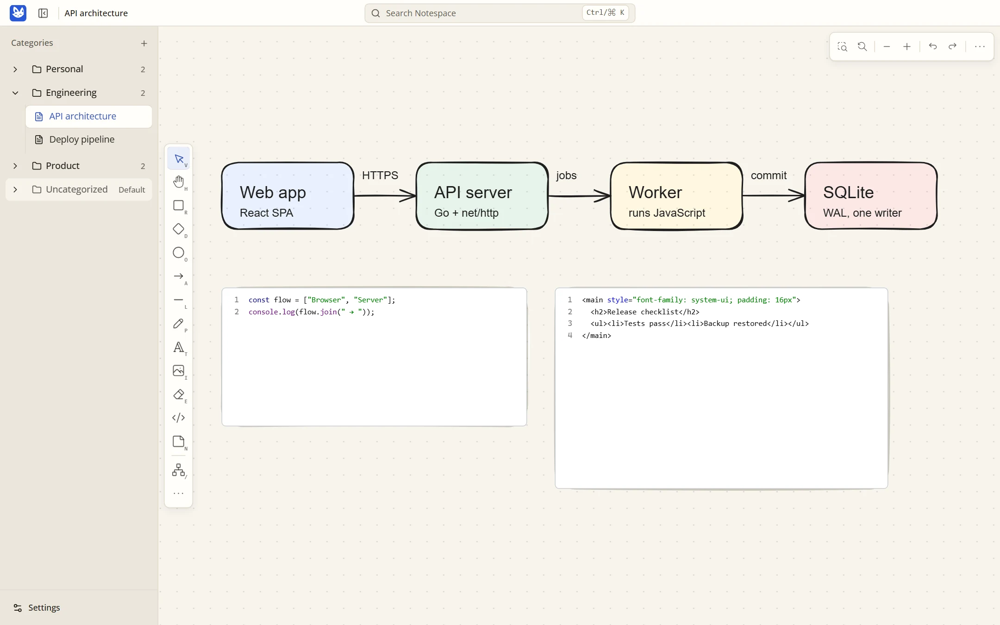

<p align="center">
  
</p>

<h1 align="center">Notespace</h1>
<p align="center">A self-hosted canvas workspace for thinking, learning, and connecting ideas.</p>
<p align="center">
  <a href="https://github.com/howlil/notespace/actions/workflows/ci.yml"></a>
  <a href="https://github.com/howlil/notespace/releases"></a>
  <a href="https://github.com/howlil/notespace/stargazers"></a>
</p>
<p align="center">
  <a href="https://github.com/howlil/notespace/releases">Download</a> ·
  <a href="docs/GETTING_STARTED.md">Get started</a> ·
  <a href="docs/README.md">Documentation</a> ·
  <a href="CONTRIBUTING.md">Contribute</a>
</p>



## What is Notespace?

Notespace brings spatial notes, diagrams, sketches, images and code into a single workspace. Run it as a Windows desktop application or self-host it in your browser. Your authored data lives in a SQLite database you control; core editing requires no hosted service.

- **Spatial canvas** — arrange ideas, diagrams, images and executable code blocks; preview HTML in an isolated surface.
- **Canvas notes** — write and connect notes inside the canvas, including linked placements that share the same note identity.
- **Workspace library** — organize workspaces by category and navigate with Quick Open (`Ctrl/Cmd+K`).
- **Durable editing** — versioned autosave, conflict recovery and save barriers.
- **Data ownership** — export a library backup, restore it transactionally and recover deleted items from Trash.

## Get started

### Windows desktop

Download the Windows installer from [GitHub Releases](https://github.com/howlil/notespace/releases). Select a stable release for normal use or a prerelease to test upcoming changes. See the [installation guide](docs/GETTING_STARTED.md) for verification and upgrade guidance.

### Self-host with Docker

With Git and Docker Compose installed:

```sh
git clone https://github.com/howlil/notespace.git
cd notespace
docker compose -f compose.yaml -f compose.local.yaml up --build -d --wait
```

Open **http://localhost:8080**. The named volume retains your library between restarts. For remote access, configure an owner password and HTTPS before exposing the service. See [self-hosting](docs/SELF_HOSTING.md) for configuration, security and recovery.

## Documentation

| Guide | Description |
| --- | --- |
| [Getting started](docs/GETTING_STARTED.md) | Install, first launch and updates |
| [User guide](docs/USER_GUIDE.md) | Canvas, notes, navigation, saves and data recovery |
| [Self-hosting](docs/SELF_HOSTING.md) | Docker, configuration, persistence and production runtime |
| [Development](docs/DEVELOPMENT.md) | Local setup, commands and verification |
| [Architecture](docs/ARCHITECTURE.md) | Runtime, code ownership and storage |
| [Testing](docs/TESTING.md) | Test ownership, CI and focused verification |
| [Desktop distribution](docs/DESKTOP_FIRST_RELEASE.md) | Maintainer release and signing contract |

## Built with

React, TypeScript, TanStack Start, Excalidraw, Go, SQLite and Tauri. The web and Windows desktop editions share the Go application and SQLite persistence boundary.

## Community

For bugs and proposals, use [GitHub Issues](https://github.com/howlil/notespace/issues). Read the [contribution guide](CONTRIBUTING.md), [code of conduct](CODE_OF_CONDUCT.md) and [support guide](SUPPORT.md). Report vulnerabilities through the [security policy](SECURITY.md), not public issue details.

Release changes are recorded in [GitHub Releases](https://github.com/howlil/notespace/releases).

## License status

This repository is publicly viewable, but an open-source license has not yet been adopted. Public visibility is not a general grant of rights to reuse or redistribute the code. See [GitHub's licensing guidance](https://docs.github.com/en/repositories/managing-your-repositorys-settings-and-features/customizing-your-repository/licensing-a-repository).
